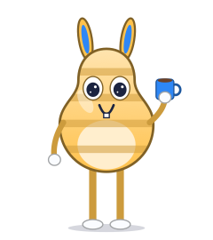
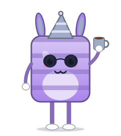

# Avatar Reminder Gallery

Characters for Avatar Reminder App (0.3 and later), the Mac menu bar app where a little character walks onto your screen to remind you to drink water, stretch and rest your eyes.

In the app, open **Settings → Characters → New Character… → Gallery** and click **Install**. Every pack here is signed with the gallery's key, so the app shows it as verified, and refuses it if anything was changed after signing.

| | Character | |
|---|---|---|
|  | **Toast** | A toasty little box who never misses a beat |
|  | **Poppy** | A spotty pink bear in round glasses |
|  | **Frost** | Cool as ice, in shades and a beanie |
|  | **Honey** | A sweet striped bunny with a mug |
|  | **Marina** | Sea-green royalty with a golden crown |
|  | **Moon** | A calm little moon with an antenna |
|  | **Kiwi** | A cheerful green frog-bear in specs |
|  | **Disco** | Always dressed for a party |

## How it works

- `gallery.json` lists the characters. The app reads it from GitHub Pages: `https://gollasandeepkumar.github.io/AvatarReminder-Gallery/gallery.json`.
- `packs/` holds one `.avatarpack` per character (a zip of an ordinary character pack, with `signature.json`).
- `thumbnails/` holds the pictures on the cards.
- Each entry carries the pack's SHA-256. The app checks it, then checks that the pack is the character the entry lists and that the gallery's key signed it.

The format is documented with the app (`docs/CHARACTER_FORMAT.md`, Sharing and Gallery).

## Adding or updating characters

The characters were made with the app's Character Builder: each is the builder's design for a seed (`avatar-tools build-character --seed`). Every pack also carries its `design.json`, so once it's installed, Character Studio can open it with **Edit…**.

1. Build the app's tools: `make tools` in the app repository.
2. Edit the list in `build.sh` (id, name, seed and version) and the summaries.
3. Run `./build.sh`. It needs the gallery's private signing key, which never goes in this repository (by default `~/avatar-gallery-key`).
4. Commit and push. GitHub Pages publishes it in a minute or two.

To change a published character, raise its version so installed copies show **Update**.

## Licence

© 2026 gollasandeepkumar. The characters are free to download and use in Avatar Reminder App.
